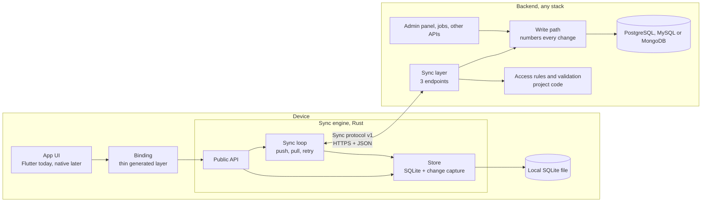

# 1. Architecture

The system has three parts: a client engine embedded in each app, a protocol
spoken over HTTP, and a thin sync layer inside each backend. Only the engine
and the protocol are shared. Everything specific to a project is supplied as
configuration or as a small amount of server code.

## 1.1 How the parts fit together

Two points in this picture matter more than the rest:

1. **The app never touches the SQLite file directly.** All reads and writes
   go through the engine, which is how every local change gets captured.
2. **Every server-side write goes through the write path**, including writes
   from an admin panel or a background job, not only writes that arrive from
   devices. A write that skips it is invisible to every device.

## 1.2 What is shared and what is per project

| Part | Shared | Per project |
| --- | --- | --- |
| Client engine (Rust) | Yes | |
| Protocol and conformance tests | Yes | |
| Schema manifest: tables, columns, scope rule | | Yes |
| Local table definitions and migrations | | Yes |
| Server address and how to obtain a login token | | Yes |
| Server sync layer: endpoints, write path, storage | Same design, written per stack | |
| Access rules: which scopes a user may read and write | | Yes |
| Validation of incoming changes | | Yes |
| Conflict policy per table | | Yes |

## 1.3 Principles

1. **Local first.** The local database is the source of truth for the UI.
   The network is never on the path of a user action.
2. **The server decides the order.** Conflicts are resolved by the order in
   which the server receives changes. Device clocks are never trusted.
3. **Smart client, simple server.** Anything that can be done on the client
   is done there, because the client is written once and the server is
   written per stack.
4. **Everything is safe to repeat.** Any request can be sent twice and any
   response can be applied twice with the same result. This is what makes
   flaky networks and app kills harmless.
5. **The engine is ignorant of the app.** No table name, column or endpoint
   of any project is compiled into the engine.
6. **Narrow boundaries.** The API between app and engine, and the protocol
   between engine and server, are both kept small so they can be re-bound
   and re-implemented cheaply.

## 1.4 Key decisions

Each decision lists the alternative that was rejected and why.

| # | Decision | Rejected alternative | Reason |
| --- | --- | --- | --- |
| D1 | Engine in Rust behind a generated binding | Engine in Dart | A Dart engine would be rewritten twice if apps move to native |
| D2 | One protocol implemented by every backend | Per-project adapters in the client | All backends are under our control, so the variation can be removed at the source |
| D3 | Protocol defined in HTTP and JSON only | Shared database triggers or a shared server library | Backends use different languages and databases |
| D4 | Data is partitioned into **scopes**, each with its own change counter | One global counter per server | Per-scope counters keep unrelated users from blocking each other and give a natural unit for access control |
| D5 | A change number is assigned inside the same transaction as the write, from a per-scope counter | Auto-increment IDs or timestamps as checkpoints | Those can become visible out of order, which makes devices silently miss changes |
| D6 | Push sends only the changed fields; pull returns whole records | Whole records both ways, or diffs both ways | Field-level push lets two devices edit different fields of one record without conflict; whole-record pull is trivially safe to repeat |
| D7 | Default conflict rule: per-field, last arrival at the server wins | CRDTs, or vector clocks | Enough for record-oriented business data and implementable on any stack in a few lines |
| D8 | Deletes win over concurrent edits | Edits resurrect deleted records | Simpler and less surprising; a project can override per table later |
| D9 | The engine owns the SQLite file and the app goes through its API | App uses its own SQLite library on the same file | Two SQLite libraries on one file in one process is unsafe, and writes could bypass change capture |
| D10 | Change capture by generated SQLite triggers | Capture inside a write API | Triggers catch every write, including raw SQL and migrations |
| D11 | Record IDs are generated on the client (UUID) | Server-assigned IDs | Records must be creatable offline and referenced by other records before sync |
| D12 | Sync is triggered by the app (foreground, after writes, on a push notification) | Engine-owned background timers | Background execution rules differ per platform and belong to the host |
| D13 | The login token is supplied by a host callback | Auth flows built into the engine | Login differs per project; the callback is a few lines per platform |

## 1.5 Glossary

- **Record**: one row or document that syncs, identified by table name and
  ID.
- **Scope**: a partition of the data that syncs as a unit and has one change
  counter, for example one user's data or one team's data. Every record
  belongs to exactly one scope. A device syncs one or more scopes.
- **Change**: one local modification to one record: an upsert carrying the
  changed fields, or a delete. Each change has a unique ID.
- **Version**: the change number of the last modification to a record,
  assigned by the server. It increases within a scope and has no gaps in
  visibility: once a device has seen version N, no smaller version can
  appear later.
- **Cursor**: an opaque checkpoint the server hands to a device, meaning
  "you have everything up to here in this scope".
- **Outbox**: the engine's local queue of changes not yet confirmed by the
  server.
- **Tombstone**: a marker that a record was deleted, kept so other devices
  learn about the deletion.
- **Manifest**: the app's description of which tables and columns sync and
  how each record maps to a scope.

## 1.6 Scope of version 1

Included:

- Record sync for tables declared in the manifest, in both directions
- Multiple scopes per device, with access granted and revoked by the server
- Per-field merge and a stricter "server wins" policy per table
- Safe retry, resume after crash, paging of large pulls
- Schema version checks and a forced-upgrade signal

Deliberately left out of version 1, with the extension point noted:

| Not in v1 | How it can be added later |
| --- | --- |
| File and image sync | Sync a metadata record; upload the file separately and store its URL |
| Live updates over a socket | A "something changed" signal that triggers a normal pull |
| Atomic groups of changes across records | A group ID on changes; the server applies a group in one transaction |
| Sharing a single record with another user | Move or copy the record to a shared scope |
| Flutter web | A WebAssembly build of the engine with a different storage layer |
| Collaborative text editing | Out of scope for this design; needs CRDTs |

## 1.7 Assumptions to confirm

These were assumed during design. Changing one of them affects the documents
named next to it.

1. Data is record-oriented business data, not shared free-text documents.
   (Architecture D7)
2. Coarse access control is enough: a user can see either all of a scope or
   none of it. (Protocol section 3)
3. Losing the older of two edits to the *same field* of the same record is
   acceptable in most tables. (Protocol section 6)
4. Datasets per scope are small enough to download in pages on first sync,
   on the order of tens of thousands of records. (Protocol section 5)
