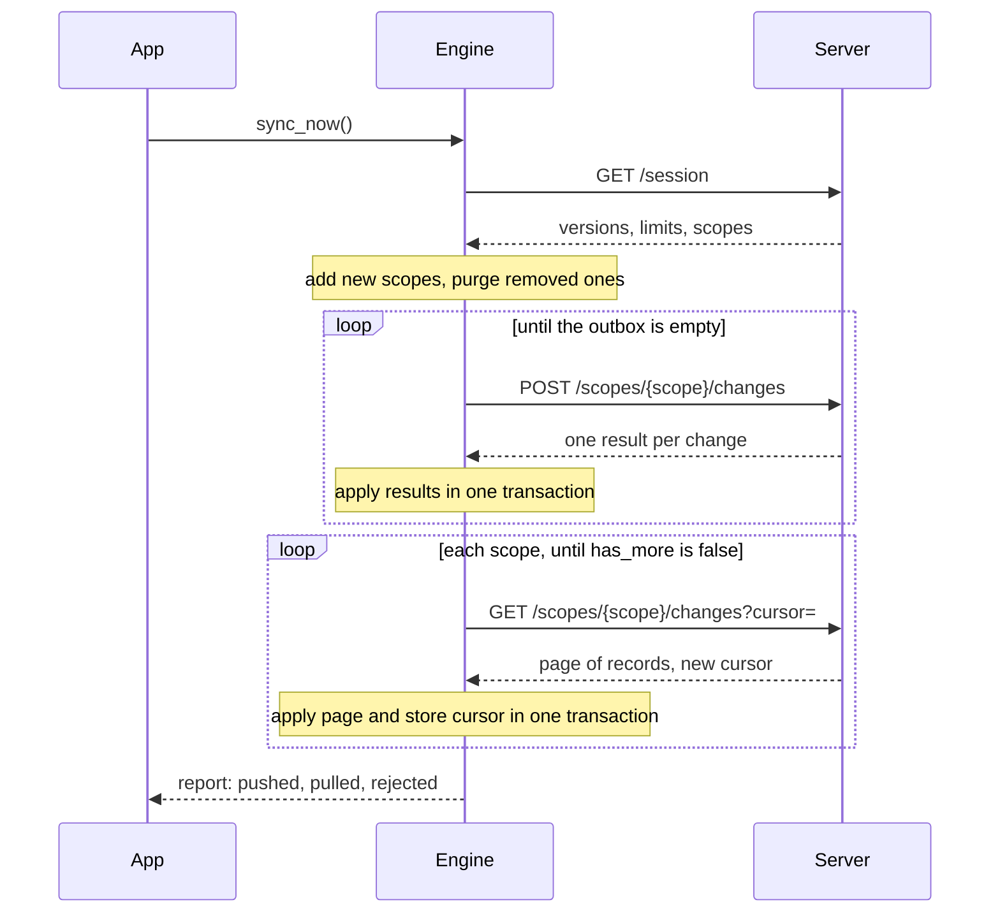

# 4. Client engine design

The engine is a Rust library that owns the app's local SQLite database,
records every local change, and exchanges changes with a server that speaks
the protocol in [02-protocol.md](02-protocol.md).

## 4.1 What the engine does and does not do

| The engine does | The engine does not |
| --- | --- |
| Open and own the SQLite file | Know any app's tables in advance |
| Run the app's SQL for reads and writes | Provide an ORM or query builder |
| Capture every write to a synced table | Decide when to sync in the background |
| Push, pull, retry, resume | Log users in or refresh tokens itself |
| Resolve conflicts by the table's policy | Show anything to the user |
| Notify the app of data changes and sync events | Sync files or images |

## 4.2 The manifest

The app describes its synced data once, at startup.

```json
{
  "schema_version": 7,
  "tables": [
    {
      "name": "stores",
      "columns": ["name", "address", "region"],
      "scope": { "column": "scope_id" },
      "conflict": "server_wins"
    },
    {
      "name": "visits",
      "columns": ["store_id", "started_at", "note", "photo_count"],
      "scope": { "column": "scope_id" }
    },
    {
      "name": "settings",
      "columns": ["theme", "language"],
      "scope": "default"
    }
  ]
}
```

| Key | Meaning |
| --- | --- |
| `schema_version` | Sent to the server as `X-Sync-Schema` |
| `name` | Table name, identical locally and on the wire |
| `columns` | The columns that sync. Any other column in the table is local-only and never leaves the device |
| `scope` | How a row maps to a scope. `{"column": "x"}`: column `x` holds the scope ID. `"default"`: the scope given in the engine configuration, for apps with one scope per user |
| `conflict` | `field_merge` (default) or `server_wins`; must match the server's setting for the table |

Requirements on a synced table:

- A text primary key named `id`, filled with a UUID by the app (the engine
  offers a helper to generate one).
- If it uses a scope column, that column is set on insert and never changed.
- Column names equal the field names the server uses.

The app creates and alters its tables through migrations (section 4.9). The
engine never creates app tables by itself.

## 4.3 Local storage

Alongside the app's tables the engine keeps four of its own, all prefixed
`_sync_`. Apps must not write to them.

| Table | One row per | Holds |
| --- | --- | --- |
| `_sync_outbox` | unsent local change | Order number, `change_id`, scope, table, row ID, operation, changed fields as JSON, `base_version`, state (`pending` or `sent`) |
| `_sync_rows` | record known to the server | Scope, the version the local row was last refreshed from, and the newest version known to include this device's own changes |
| `_sync_scopes` | scope | Access level, cursor, state (`active`, `resyncing`) |
| `_sync_meta` | setting | Device ID, local migration version, last sync time |

The database runs in WAL mode with one writer connection and a small pool of
read connections. All writes, from the app and from sync, go through the
single writer, so they never contend.

## 4.4 Change capture

For every table in the manifest the engine generates three SQLite triggers:
after insert, after update, after delete. Each trigger appends one row to
`_sync_outbox` in the same transaction as the write itself.

- **Insert**: an `upsert` with all synced columns, `base_version` null.
- **Update**: an `upsert` with only the synced columns whose value actually
  changed. An update that touches only local-only columns records nothing.
- **Delete**: a `delete`.
- `base_version` is the newest server version the engine knows for that row
  at the moment of the write.

Because capture is in triggers, it cannot be bypassed: raw SQL, batch
statements and migrations are all captured.

When the engine itself writes rows it received from the server, capture is
switched off for that transaction through a connection-level flag the
triggers check. Triggers are regenerated whenever the manifest changes.

## 4.5 The sync cycle

One cycle runs at a time. A request to sync while a cycle is running does
not start a second one; it schedules one more cycle to run right after.



Order matters:

1. **Session first**, so a forced upgrade or a revoked scope is noticed
   before any data moves.
2. **Push before pull.** After a successful push the outbox is nearly empty,
   which keeps the pull step simple.
3. **Unfinished sends first.** If the app was killed after sending a batch
   but before reading the response, those entries are still marked `sent`.
   The next cycle resends exactly that batch before anything else. The
   server recognises the change IDs and returns the original results.

The app keeps reading and writing during a cycle. Writes made mid-cycle land
in the outbox and go out in the next batch or the next cycle.

## 4.6 Building a push batch

Before sending, pending outbox entries for the same row are merged:

| Pending entries for one row | Sent as |
| --- | --- |
| upsert, upsert | One upsert with the fields of both; later values win |
| upsert(s), then delete | One delete |
| insert, then delete, of a row the server never saw | Nothing; both are dropped |

Rules:

- Entries keep their local order, so a parent created before its child is
  also sent before it. Merged upserts take the position of the first entry;
  a delete takes the position of the last.
- An entry marked `sent` is frozen. It is never merged or edited, because
  the server may already have applied it under its `change_id`.
- A batch contains entries of one scope and respects the limits from the
  session.
- Order is guaranteed within a scope, not across scopes. Records should
  reference only records of their own scope or of read-only scopes.

## 4.7 Applying results and pulled records

**Push results**, applied in one local transaction per batch:

| Status | Engine action |
| --- | --- |
| `applied` | Remove the entry. Remember the returned version as the base for later changes to that row |
| `conflict` | Remove the entry and any later pending entries for that row. Overwrite the local row with the returned record, or delete it. Emit an event |
| `rejected` | Same as `conflict`, with the server's code and message in the event |

**Pulled records**, applied one page per local transaction together with
the new cursor:

| Situation | Engine action |
| --- | --- |
| Record is not newer than what the local row already reflects | Skip |
| No pending changes for the row | Replace the local row, or delete it for a tombstone |
| Pending changes, tombstone received | Delete the row, drop the pending changes, emit an event |
| Pending changes, policy `field_merge` | Write the server's record, then re-apply the pending fields on top. The pending changes stay in the outbox |
| Pending changes, policy `server_wins`, server version newer than their base | Write the server's record, drop the pending changes, emit an event |

Local-only columns are preserved in every case except deletion.

The engine decides conflicts with the same rules as the server, so whichever
side notices a conflict first, the outcome is the same.

## 4.8 Failure handling

Every step is designed so that being killed at any point loses nothing.

| Failure point | State afterwards | Recovery |
| --- | --- | --- |
| During a local write | SQLite rolls back both the data and the outbox entry | None needed |
| After sending a push, before the response | Entries marked `sent` | Resent first in the next cycle; the server deduplicates |
| While applying push results | The transaction rolls back; entries still `sent` | Same as above |
| While applying a pull page | The transaction rolls back; cursor unchanged | The same page is fetched again |
| Network down | Nothing changes | Next cycle |
| Token expired (401) | Nothing changes | Ask the host for a token, retry once |
| Server asks for upgrade (426) | Sync stops, outbox kept | Resumes after the app is updated |
| Cursor expired (410) | Scope marked `resyncing` | Pull from the beginning, then remove local rows of that scope that were not returned and have no pending changes |
| Scope revoked | Scope's rows and pending changes removed | Event tells the app what was dropped |

Within one cycle a failed request is retried a few times with short,
jittered delays. After that the cycle ends with an error and the host
decides when to try again.

## 4.9 Migrations

Local schema changes are a list of numbered steps supplied in the
configuration. On open, the engine runs the steps not yet applied, in one
transaction, with change capture off, then regenerates the triggers.

A step is plain SQL plus optional outbox instructions, because unsent
changes refer to tables and columns by name:

| Instruction | Effect on unsent changes |
| --- | --- |
| `rename_table(old, new)` | Entries are renamed |
| `rename_column(table, old, new)` | Field names inside entries are renamed |
| `drop_column(table, column)` | The field is removed from entries; entries left empty are dropped |
| `drop_table(table)` | Entries for the table are dropped |

This is how a breaking schema change stays safe for a user who updates the
app while holding unsent work.

## 4.10 Public API

The API is deliberately small. Types crossing the boundary are plain data,
so the same surface can be exposed to Dart, Swift and Kotlin.

| Call | Purpose |
| --- | --- |
| `open(config)` | Open or create the database, run migrations, install triggers |
| `execute(sql, params)` | One write statement |
| `write_batch(statements)` | Several write statements in one atomic transaction |
| `query(sql, params)` | Read rows |
| `watch(sql, params)` | Stream that re-emits the result whenever a table it reads changes |
| `sync_now()` | Run one sync cycle and return a report |
| `status()` | Stream of sync status: phase, number of pending changes, last sync time, last error |
| `events()` | Stream of things the user may need to know (see below) |
| `new_id()` | Generate a UUID for a new record |
| `sign_out(discard_pending)` | Remove synced data and sync state from the device |
| `close()` | Flush and close |

Configuration: database path, manifest, server base URL, default scope,
migration steps, and a **token provider**, a callback the engine invokes to
get the current bearer token.

Values in parameters and rows are one of: null, integer, real, text, blob.

Status phases: `idle`, `syncing`, `offline`, `error`, `upgrade_required`.

Events:

| Event | Carries |
| --- | --- |
| `change_rejected` | Table, record ID, code, message |
| `change_conflicted` | Table, record ID, reason |
| `scope_added` / `scope_removed` | Scope ID, number of dropped changes |
| `resync_started` / `resync_finished` | Scope ID |
| `upgrade_required` | Minimum schema version |

## 4.11 What stays outside the engine

The binding package for each platform is thin but not empty. It contains:

- The generated glue code.
- **Sync scheduling**: call `sync_now()` when the app comes to the
  foreground, when connectivity returns, a short moment after local writes,
  on a push notification, and from the platform's background task API.
- The token provider implementation.
- Optional conveniences in the host language, such as typed row mappers.

Keeping scheduling here is what lets the engine stay free of timers and
platform lifecycle code.

## 4.12 Consequences for app code

- The app cannot use another SQLite library on the same file. Database
  packages that insist on owning the connection (for example an ORM with its
  own SQLite build) need an adapter that forwards to the engine, or are not
  used for synced data.
- Record IDs are UUID strings, including in foreign keys.
- The app should treat `change_rejected` and `change_conflicted` as real
  product cases and decide what the user sees.

## 4.13 Testing strategy

The engine's logic is tested without devices or networks.

1. **Unit tests** on the pure rules: batch merging, re-applying pending
   fields, conflict decisions.
2. **Simulation tests.** The transport is an interface. In tests it is
   replaced by an in-process server that can drop requests, drop responses,
   delay, and reorder. The engine is also "killed" between any two
   transactions and reopened.
3. **Convergence property test.** Several simulated devices perform random
   operations with random failures. When activity stops and every device
   has synced, all devices and the server must hold identical data, and no
   acknowledged change may be missing.
4. **Integration tests** against the reference server over real HTTP.

## 4.14 Implementation notes

Where the code in `crates/sync-engine` differs from or adds to the design
above:

| Topic | Implementation |
| --- | --- |
| Threading | The engine is synchronous: every call blocks. No async runtime is used. Bindings call it from a background thread. Only one sync cycle runs at a time; a second request during a cycle returns at once and the running cycle does one more round. |
| Connections | One SQLite connection behind a mutex, not a writer plus a read pool (section 4.3). Reads wait for a running write. A read pool can be added without changing the API. |
| Downloads from the beginning | Every download that starts without a cursor ends like a resync: local rows of the scope that the server did not return, and that have no unsent changes, are removed. This also covers a first download after the device already uploaded rows. |
| Writes to a read-only scope | Rejected on the device with code `read_only_scope`; the scope is downloaded again, which restores the rows. |
| Writes to a scope not in the session | Rejected on the device with code `scope_forbidden`; the rows are removed. |
| A single change too large for the server | Rejected with code `too_large`; the scope is downloaded again. A batch refused as too large is split in half and resent. |
| Moved records | A record that reappears in another scope takes that scope; a tombstone from its old scope is ignored. The local scope column is updated. |
| Value types | Synced columns may hold null, integers, reals and text. Blob values cannot be captured by the triggers; keep files out of sync. Columns listed in `json_columns` hold JSON text and sync as JSON values. |
| Local-only columns | Must be nullable or have a default, because a record from the server is inserted with synced columns only. |
| Engine tables | `execute` and `write_batch` refuse SQL that mentions `_sync_`. |
| Resync events | `resync_finished` is sent only in the same cycle as its `resync_started`. |
| Upgrade required | The server's 426 reply carries `min_schema_version`, passed on in the `upgrade_required` event. |
| Default scope | Stored at open. To switch user, call `sign_out` and open with the new default scope. |
| Logging | Through the `log` crate. `debug_dump` returns the sync state as JSON without record data. |

### Public API as built

The surface matches section 4.10, with these concrete forms:

- `watch(sql, params, callback)` takes a callback and returns an ID for
  `unwatch`. The callback runs with no engine lock held.
- Status, events and table changes are delivered to listeners registered
  with `add_listener`. The Flutter binding turns them into streams.
- `crates/sync-ffi` is the binding-friendly version of the same API: plain
  data types, manifest and migrations as JSON, and three callback traits
  (token provider, listener, watcher).
